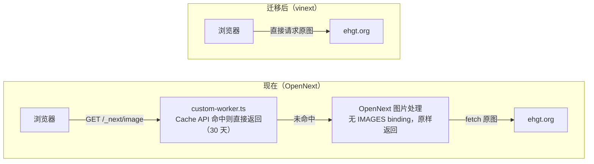

# vinext 迁移评估

评估日期：2026-10-28（首次评估 2026-10-02）· 评估对象：`apps/web`（Next.js 16.2.4 + @opennextjs/cloudflare 1.19.4）· 对照版本：vinext 1.3.1

## 结论
仍不建议现在把生产环境切到 vinext。上次的主要障碍 next-intl 已基本解除，现在不切的原因在 vinext 自身：README 仍不承诺能直接替换 Next.js、对生产使用的说法是谨慎使用；版本迭代快，小版本还会带需要手动处理的变化；部署切流量时返回 503 的 #3623 也还开着（官方部署命令可以避开）。再加上迁移要改的地方不少，对本项目的收益又有限，暂时不值得切。

另有一件和迁移无关、但更急的事：项目的 Next.js 16.2.4 落后多批安全修复，OpenNext 最新版也要求 Next ≥ 16.4.1。这是现有生产环境本身的问题，不迁移也要升级；它也不妨碍迁移，vinext 面向的是 Next.js 16.x 的 API，React 版本由 `vinext init` 自动升级。建议把它排在试跑 vinext 之前，只是因为它紧急、改动小。

试跑时要先把 `middleware.ts` 移到 `src/`，否则 vinext 会忽略它。

## 距上次评估的变化
上次列的三个重新评估信号：

| 信号 | 现状（2026-10-28） |
| --- | --- |
| [#177](https://github.com/cloudflare/vinext/issues/177) 关闭 | 未关闭，7 月之后没有新回复。上游在 [#3953](https://github.com/cloudflare/vinext/pull/3953) 中说明问题已由 [#3513](https://github.com/cloudflare/vinext/pull/3513) 修复，并把 next-intl 官方的 App Router playground（7 种配置）和 App Router 示例连同它们的 Playwright 测试放进 CI，跑在 Workers 生产构建上 |
| `vinext check` 不再把 next-intl 标为部分支持 | 已满足，1.2.0 起标为支持 |
| 1.0.x 连续稳定几个版本，部署类问题（如 [#3623](https://github.com/cloudflare/vinext/issues/3623)）已修复 | 部分满足。4 周里发了 1.1.0 到 1.3.1 共 5 个版本，每个版本都有几十项修复，1.3.0 还带了 3 项升级时要留意的行为变化。#3623 仍未关闭，维护者认为它只出现在单版本部署（直接 `wrangler deploy`）中，`@vinext/cloudflare deploy` 走渐进发布，可以避开 |

其他变化：

- next-intl：本项目的写法和 next-intl 官方 App Router 示例基本一致（layout 里 `setRequestLocale` + `generateStaticParams` + `NextIntlClientProvider`，语言切换用 `useTransition` + `router.replace`）。该示例的 10 个测试在 vinext 上全部通过，[#3973](https://github.com/cloudflare/vinext/pull/3973) 没有改动 vinext 源码。1.3.1 还修了 layout 调 `notFound()` 时 not-found 页拿不到 Provider、返回 500 的问题（[#4045](https://github.com/cloudflare/vinext/issues/4045)），本项目没有 `not-found.tsx`，不受影响
- React 下限从 19.2.6 提到 19.3.1（1.2.1，[#3995](https://github.com/cloudflare/vinext/pull/3995)），因为 React 19.3.1 修复了 `react-server-dom-webpack` 的 Flight server。React 低于下限时 `vinext build` 直接报错并给出安装命令
- vinext 开始有自己的安全公告：2026-10-14 公布了 2 条（high 和 medium 各一），都在 1.2.0 修复，涉及 Server Action 和缓存 key，本项目都没用到
- Cloudflare 的口径更明确了：[OpenNext 指南](https://developers.cloudflare.com/workers/framework-guides/web-apps/opennext/)（2026-10-12 更新）开头写着新项目推荐 vinext，已有的 OpenNext 应用"兼容性允许时"迁移；Wrangler 自动配置 Next.js 项目时也默认用 vinext。不过 [Next.js 指南](https://developers.cloudflare.com/workers/framework-guides/web-apps/nextjs/)（2026-08-25 更新，早于 1.0）仍写着 vinext is in beta
- OpenNext 1.20.3 起实验性支持 `proxy.ts`（需要 `nodejs_compat`，本项目已开启），[todo.md](todo.md) 里搁置的 `middleware.ts` → `proxy.ts` 迁移不必等 vinext
- 新发现：vinext 在 `src/app` 结构下只在 `src/` 里找 middleware，本项目放在 `apps/web` 根目录的 `middleware.ts` 会被忽略，见兼容性对照

## 留在 OpenNext 也要升级
这一节和迁不迁 vinext 无关：即使一直留在 OpenNext，下面的问题也要处理。

项目的 Next.js 16.2.4 发布于 2026-04-15。5 月以来 vercel/next.js 公布了 35 条安全公告，按版本范围有 33 条覆盖 16.2.4，其中 critical 5 条、high 13 条、medium 12 条、low 3 条。

- 5 条 critical 分别涉及 `use cache`、Next 自带的图片优化（两条）、`next/og` 和 Windows 部署，本项目都没用到。图片优化相关的几条针对 Next 自带的优化器，本项目的 `/_next/image` 由 OpenNext worker 里的 `handleImageRequest` 处理，不经过它
- high 里有覆盖本项目所用功能的，例如 Server Components 的 DoS（CVE-2026-23870）和 App Router 中 middleware/proxy 被绕过（CVE-2026-44575 等）。本项目的 middleware 只做语言路由，绕过的实际影响有限，但 DoS 一类应尽快修
- OpenNext 已跟着收紧版本要求：1.20.7 起要求 Next ≥ 16.3.6（理由是 `next/og` 的远程代码执行漏洞 CVE-2026-94545），最新的 1.20.13 要求 `next >= 16.4.1`、`wrangler ^4.148.0`
- OpenNext 仍在快速发版：1.19.4 之后共 21 个版本，10 月就有 6 个，一般在 Next 安全版本发布后几天内跟进

升级时要注意：

- 根目录的 `wrangler`（现在是 `^4.85.0`）由 web 和 crawler 共用，升级后 crawler 的 dev 和 deploy 也要验证
- [custom-worker.ts](../apps/web/custom-worker.ts) 依赖的三个 Durable Object 导出和 `/_next/image` 拦截，在 1.20.13 的 worker 模板里都还在，预计不用改，但要在 preview 下确认图片缓存仍然生效

## vinext 1.0 发布文要点
Cloudflare 于 2026-09-28 发布 [Next.js applications, powered by Vite: introducing Vinext 1.0](https://blog.cloudflare.com/vinext-nextjs-on-vite/)，称 vinext 已从 2 月的 AI 实验成长为有客户在高流量生产环境使用的框架。

- 来历：2 月首发时是"一个工程师加一堆 token、一周复刻 Next.js"的实验
- 路由：同时支持 App Router、Pages Router 和混合应用，包括 RSC、Server Actions、API 路由、route handler、middleware 和客户端导航
- 页面生命周期：SSR、构建期预渲染、`output: "export"` 静态导出、页面级 ISR；支持后台和按需 revalidate，可按 path 或 tag 失效
- cache warming：新 Worker 版本先以 0% 流量部署，向该版本请求页面填满缓存后再切流量；还能按真实流量挑出热门页面预热
- 可观测性：兼容 OpenTelemetry 和 Sentry，在 Workers 上接入 Workers Observability
- Workers 一等支持：dev 和生产都跑在 workerd 里，可直接使用 Images、Hyperdrive 等绑定
- 承认的短板：`"use cache"`（Cache Components）只有有限支持，文章称多数团队并没有在用
- 维护方式：每天由 agent 审阅 Next.js canary 的改动并开追踪 issue，每晚用 Next.js 测试套件重新生成兼容性矩阵

迁移和部署命令：

```bash
npx vinext check && npx vinext init          # 迁移现有项目
npx @vinext/cloudflare deploy --warm-cache   # 部署到 Workers，并在切流量前预热缓存
```

## 宣传与现状的出入
博客的口径比仓库自己的说明乐观，以下几点要打折看：

- "99%+ 兼容"是 Next.js 测试套件在"客户最常要的功能"上的通过率，且排除了 Cache Components，不等于 99% 的应用能直接迁移。README 的说法是约 94% 的 Next.js 16 API 有完整或部分支持。[兼容性看板](https://vinext.dev/compatibility) 2026-10-28 的结果是：已支持部分通过率 99.6%，全量 96.2%，其中 App Router 全量 95.0%；跑的是 Next.js 16.2.6 的测试套件，而 Next.js 已经到 16.4.3
- 1.0 发布文没有性能数据。1.1 发布文给了 vinext 自己的基准（33 个路由的 App Router 应用）：生产构建比 Next.js 16（Turbopack）快约 27%，dev 冷启动反而慢约 11%
- 截至 2026-10-28，README 顶部仍写着 "Under active development… not yet a drop-in replacement for every application or production workload"，FAQ 对生产使用的回答仍是 "You can, with caution"
- README 自己说 OpenNext 更成熟、覆盖的 API 更多，求稳就选 OpenNext
- 版本很新、迭代很快：首个版本发布于 2026-02-16，至今共 88 个版本；1.0.0 发布于 2026-09-28，之后是 1.1.0（10-08）、1.2.0（10-14）、1.3.0（10-20），最新为 1.3.1（10-25）
- 截至 2026-10-28，仓库有 294 个 open issue（10-02 为 263）、341 个 open PR；10-02 以来新开 105 个 issue、关闭 73 个，合并 441 个 PR
- 工具链本身还在变：`vinext init` 的 Cloudflare 默认配置是新的 `cf` CLI 和 `cloudflare.config.ts`。目录里已有 wrangler 配置时 init 会直接报错，要么先把绑定迁到 `cloudflare.config.ts`，要么加 `--legacy-wrangler-cloudflare-init` 保留 wrangler。1.3 新增的 Worker Previews 只支持 `cloudflare.config.ts` 项目

## 本项目兼容性对照
项目用的 Next.js 16.2.4 在 vinext 的目标范围（16.x）内。必须实测的是 next-intl，行为会变的是图片，middleware 要挪位置，其余多为确定的改动。

| 本项目用法 | vinext 下的情况 | 需要做什么 | 处理 |
| --- | --- | --- | --- |
| [middleware.ts](../apps/web/middleware.ts) 放在 `apps/web` 根目录，页面在 `src/app` | vinext 在 `src/app` 结构下只找 `src/proxy.*` 和 `src/middleware.*`，根目录的文件会被静默忽略；Next 16.2.4 能识别它（构建产物 `middleware-manifest.json` 里有）。忽略后 `/about` 这类无语言前缀的路径不再重定向到 `/en/about`，`/` 不受影响（根页面自己做跳转） | 移到 `src/middleware.ts` 并改 `routing` 的引用路径，或直接改成 `src/proxy.ts`。这也是 Next 文档约定的位置（和 `app/` 同级），可以先在 OpenNext 下做 | 需改动 |
| next-intl：6 个 client 组件使用其 hooks，结构为 Provider(client) → page(server) → client 组件 | `vinext check` 1.2.0 起标为支持。[#177](https://github.com/cloudflare/vinext/issues/177) 仍未关闭，但上游说明已由 [#3513](https://github.com/cloudflare/vinext/pull/3513) 修复，next-intl 官方 playground 和 App Router 示例在 vinext CI 的 Workers 生产构建上通过 | 在 `vite dev` 和生产构建（workerd）下实测中英文切换和这 6 个组件；`createNextIntlPlugin` 可去掉，vinext 会自动识别 `src/i18n/request.ts` | 需实测 |
| `next/image` 远程 `fill` 图（ehgt.org，[image-with-skeleton.tsx](../apps/web/src/components/image-with-skeleton.tsx)） | 直接渲染为 ``，不经过 `/_next/image`；`remotePatterns` 仍会校验 | 决定是否保留同源代理和缓存，见下一节 | 行为变化 |
| [custom-worker.ts](../apps/web/custom-worker.ts)：包装 OpenNext worker，给 `/_next/image` 加 30 天 Cache API 缓存 | 依赖 `.open-next/worker.js`，无法沿用；vinext 访问绑定不需要自定义入口 | 删除，或按新的图片方案重写 | 需改动 |
| [open-next.config.ts](../apps/web/open-next.config.ts)：`staticAssetsIncrementalCache` | 不再使用；对应能力是 vinext 的缓存 adapter | 删除；以后需要页面缓存时再配 adapter | 需改动 |
| `getCloudflareContext().env`（[toplist-data.ts](../apps/web/src/lib/toplist-data.ts)） | vinext 下没有这个 API，改用 `cloudflare:workers` 的 `env` | `import { env } from 'cloudflare:workers'` | 需改动 |
| [next.config.ts](../apps/web/next.config.ts)：`reactCompiler: true` | 被忽略 | 改用 `vinext({ react: { compiler: true } })`，安装 `oxc-transform-react`，需要 `@vitejs/plugin-react` 6.1+；只作用于客户端 | 需改动 |
| [wrangler.jsonc](../apps/web/wrangler.jsonc)：D1 远程绑定、自定义域名、observability、兼容性标志 | `vinext init` 默认生成 `cf` CLI 和 `cloudflare.config.ts`，目录里有 `wrangler.jsonc` 时不加参数会直接报错。加 `--legacy-wrangler-cloudflare-init` 时会就地改写 `wrangler.jsonc`，但 `main` 和 `assets` 只在缺失时才补，本项目现有的值指向 `custom-worker.ts` 和 `.open-next/assets`，不会被替换 | 保留 wrangler（crawler 仍用 wrangler）时，先删掉 `main` 和 `assets` 再跑 init，让它按 vinext 的默认值补上；或先把 D1、域名等配置迁到 `cloudflare.config.ts` | 需改动 |
| Nx：`@nx/next/plugin` 推断 build、dev、start | vinext 保留 `next.config.ts`，Nx 仍会推断出 `next build`；vinext 的文档和 issue 里没有 Nx 相关内容 | 手动定义 build、dev、preview、deploy target | 需改动 |
| `package.json` 脚本，含 `next experimental-analyze` | `vinext init` 添加 `dev:vinext`、`build:vinext`、`start:vinext`、`deploy:vinext`；analyze 没有对应命令 | 重写脚本，bundle 分析改用 Vite 生态的工具 | 需改动 |
| React 19.2.0 | vinext 1.2.1 起要求 `react`、`react-dom`、`react-server-dom-webpack` ≥ 19.3.1，`@vitejs/plugin-rsc` ≥ 0.5.37（0.5.38 起内置 19.3.1 的 RSDW），`vite` ^8；`vinext init` 会自动升级 React | 升级依赖 | 需改动 |
| route handler、`cookies()`/`headers()`、`redirect`/`notFound`、`next/link`、`generateStaticParams` | 均支持 | 无 | 无需改动 |

## 图片请求链路的变化
现在缩略图经本站 Worker 代理并缓存 30 天；迁到 vinext 后，浏览器会直连 ehgt.org。



- 现在没配 `IMAGES` binding，OpenNext 的 `/_next/image` 不做压缩或格式转换，只是原样返回原图（见 `@opennextjs/cloudflare` 的 `dist/cli/templates/images.js`）。实际作用是同源代理，加上 `custom-worker.ts` 的边缘缓存
- 直连的好处是图片请求不再消耗 Worker 调用；代价是失去同源代理和边缘缓存。[todo.md](todo.md) 里记录过直连测速"速度也还行"
- 若要保留代理：给 `<Image>` 传 `loader` 属性（`next.config` 里的 `images.loader` 会被忽略），指向一个代理并缓存图片的 route handler

## 迁移收益
1.0 主打的预渲染、ISR 和 cache warming 对本项目几乎没用，能拿到的主要是工具链层面的改善。

- 最近一次 OpenNext 构建只预渲染了 `/_global-error` 和 `/_not-found`。首页读 cookies 和 searchParams、每个请求查 D1，about 页也是动态渲染
- 因此 `staticAssetsIncrementalCache` 实际没有缓存任何页面，vinext 的页面缓存能力同样用不上
- 实际能拿到的：
    - 构建更快：按 vinext 自己的基准，生产构建比 Next.js 16 快约 27%，但 dev 冷启动慢约 11%；本项目未实测
    - 客户端 JS 更少：1.3 起按路由合并 client 组件的 chunk，官方原型上每页 JS（gzip）比 Next.js 少约 44%，LCP 仍略慢（900 ms 对 852 ms）
    - dev 直接跑在 workerd 里，绑定原生可用，不再需要 `initOpenNextCloudflareForDev`
    - 去掉 `custom-worker.ts` 这类依赖 OpenNext 构建产物的写法
    - 不运行 Next.js 的服务端代码，Next.js 的安全公告大多不直接适用（Cloudflare 对 5 月那批漏洞的说明是 vinext 的架构绕开了受影响的代码路径）。但 vinext 有自己的公告，还要及时跟进 React 的补丁版本，相当于换了一条要跟的补丁线
- 上次列的 `proxy.ts` 收益已不是 vinext 独有，OpenNext 1.20.3 起实验性支持

工具链收益仍属锦上添花。真正的变化在长期方向：Cloudflare 已把 vinext 作为 Workers 上运行 Next.js 的默认方式，OpenNext 指南也改成了维护现有应用的定位，长期看迁移的理由在增加。但 OpenNext 目前仍在快速跟进 Next 的安全版本，不必急于一时。

## 关于 vinext check
`vinext check` 是 vinext 自带的迁移前静态扫描，只读、不改文件，适合当初筛清单，不能代替实测。`vinext init` 开头也会自动跑一遍（可用 `--skip-check` 跳过）。

```bash
cd apps/web              # monorepo 里要在 Next 应用目录下运行
pnpm dlx vinext check    # 或 npx vinext check，无需先安装 vinext
```

它检查四类内容：

- 导入：源码里的 `next/*` import，对照内置支持表
- next.config：逐项对照配置选项
- 第三方库：用 `package.json` 的依赖对照已知库表
- 项目结构：路由类型，页面、layout、route handler 的数量，`middleware.ts` 与 `proxy.ts` 是否并存，是否用了 `__dirname` / `__filename`

评分方式：支持记 1 分，部分支持记 0.5 分，不支持记 0 分，再取平均。它只反映检测到的条目，不代表应用能跑起来的概率。

本项目扫描结果：

- 2026-10-02，vinext 1.0.1 实测：总分 77%（10 项支持、3 项部分支持、2 项问题），去掉误报后按同一公式约 88%
- 2026-10-28，vinext 1.3.1：本次没有实际运行，按源码推算。1.0.1 到 1.3.1 之间，`check.ts` 里本项目会命中的条目只有 next-intl 从部分支持改为支持，忽略规则也没变。预计总分 80%（11 项支持、2 项部分支持、2 项问题），去掉误报后约 92%

| 条目 | 结果（1.3.1） | 说明 |
| --- | --- | --- |
| next-intl | 支持（1.0.1 为部分支持） | 说明里提到的几个 experimental 选项本项目都没用 |
| `images` 配置 | 部分支持 | 没配 optimizer 时原样返回图片 |
| `reactCompiler` | 部分支持 | 被忽略，需改用 vinext 的配置 |
| `next/dist/server/next-server.js` | 问题（误报） | 来自 `.open-next/` 构建产物 |
| `__dirname` / `__filename` | 问题（误报） | 来自 `.open-next/` 和 `.wrangler/tmp/` 构建产物 |

局限：

1. 不运行应用，测不出运行时问题。#177 中有用户的报告是 96%、0 个问题，实际 client 组件报错。next-intl 的标记 2026-09-28 才改为部分支持（[#3507](https://github.com/cloudflare/vinext/pull/3507)），2026-10-14 又改为支持（[#3953](https://github.com/cloudflare/vinext/pull/3953)），反映的是上游测试的结果，不代表本项目能跑通
2. 会误报。它固定跳过 `node_modules`、`.next`、`dist`、`.git`，且只读扫描目录及其子目录里的 `.gitignore`。本仓库在根目录 `.gitignore` 里忽略 `.open-next` 和 `.wrangler`，在 `apps/web` 运行时这两个目录会被扫进去。解决办法是在 `apps/web` 加一个 `.gitignore` 列出这两个目录；不要直接删 `.wrangler`，里面可能有本地 D1 数据
3. 只认识表里的库。`@tanstack/react-table`、`zustand`、`react-day-picker` 等不在表里，不会出现在报告中
4. 只看 Next.js 层面。`custom-worker.ts`、`getCloudflareContext()`、`wrangler.jsonc`、Nx 配置都不在报告里，但迁移时都要改
5. 会漏报。它和插件一样，在 `src/app` 结构下只在 `src/` 里找 middleware，根目录的 `middleware.ts` 既不计分也不提示。1.0.1 的结果里没有 middleware 一项就是这个原因

## 建议
先在 OpenNext 上完成安全升级，再开分支试跑 vinext；试跑全部通过、部署问题有着落之后，再考虑切换生产。升级排在前面是因为它紧急，不是迁移的前置条件。

第一步，升级 OpenNext 这条线（和 vinext 无关，优先做）：

- `next` 升到 16.4.3（至少 16.4.1），`@opennextjs/cloudflare` 升到 1.20.13，根目录 `wrangler` 升到 4.148 以上（目前最新 4.154.0）
- 可以顺手把 `react`、`react-dom` 升到 19.3.1（也是 vinext 的下限），把 `middleware.ts` 移到 `src/`
- 验证 `pnpm nx build web`，在 preview 下检查首页、`/api/data` 和图片缓存，再验证 crawler 的 dev 和 deploy
- 之后可以重试 [todo.md](todo.md) 里的 `proxy.ts` 迁移

第二步，开分支试跑 vinext。`vinext init` 不改源码、`next.config` 和 `tsconfig.json`，也不移除 Next.js 依赖；它会安装依赖（React 低于 19.3.1 时自动升级），生成 `vite.config.ts`，添加 `*:vinext` 脚本。`apps/web` 里已有 `wrangler.jsonc`，要保留 wrangler 就必须加参数，并先删掉其中的 `main` 和 `assets`（见兼容性对照）：

```bash
cd apps/web
pnpm dlx vinext check
pnpm dlx vinext init --platform=cloudflare --legacy-wrangler-cloudflare-init
```

试跑验证清单：

- [ ] `middleware.ts` 移到 `src/` 后，`/about` 能重定向到 `/en/about`，无效路径返回 404 而不是 500
- [ ] 中英文切换正常，6 个使用 next-intl 的 client 组件在 `vite dev` 下没有 intl context 报错
- [ ] 同样的检查在生产构建（workerd）下通过
- [ ] 首页和 `/api/data` 通过 `cloudflare:workers` 的 `env` 正常查询 D1
- [ ] 决定图片方案：接受直连 ehgt.org，或用 `loader` + route handler 保留代理和缓存
- [ ] Nx 的 build、dev、deploy target 走通，部署用 `vinext-cloudflare deploy`（渐进发布，避开 #3623）

切换生产的条件：

- 上面的清单全部通过
- #3623 关闭，或确认用 `vinext-cloudflare deploy` 部署时不复现
- 小版本不再频繁带需要手动处理的变化（1.3.0 还有 3 项）

## 参考资料
- [Next.js applications, powered by Vite: introducing Vinext 1.0](https://blog.cloudflare.com/vinext-nextjs-on-vite/)（Cloudflare 博客，2026-09-28）
- vinext 发布文：[1.1](https://vinext.dev/blog/vinext-1-1)（2026-10-08）、[1.2](https://vinext.dev/blog/vinext-1-2)（2026-10-14）、[1.3](https://vinext.dev/blog/vinext-1-3)（2026-10-20）
- [vinext 兼容性看板](https://vinext.dev/compatibility)
- [cloudflare/vinext README](https://github.com/cloudflare/vinext)
- [Differences from Next.js](https://github.com/cloudflare/vinext/blob/main/docs/reference/differences.mdx)
- [Deploy to Cloudflare Workers](https://github.com/cloudflare/vinext/blob/main/docs/deploying/cloudflare.mdx)
- [migrate-to-vinext 兼容性参考](https://github.com/cloudflare/vinext/blob/main/.agents/skills/migrate-to-vinext/references/compatibility.md)
- [vinext check 源码（check.ts）](https://github.com/cloudflare/vinext/blob/main/packages/vinext/src/check.ts)
- [vinext 插件入口（index.ts）](https://github.com/cloudflare/vinext/blob/main/packages/vinext/src/index.ts)：`middlewareConventionDir` 决定在哪个目录找 middleware
- [vinext init 的 Cloudflare 配置（init-cloudflare.ts）](https://github.com/cloudflare/vinext/blob/main/packages/vinext/src/init-cloudflare.ts)：已有 wrangler 配置时的报错，以及 `updateWranglerConfigForCloudflare` 只补缺失的 `main` 和 `assets`
- [vinext 的 next/image 实现（image.tsx）](https://github.com/cloudflare/vinext/blob/main/packages/vinext/src/shims/image.tsx)
- [vinext 的 next-intl e2e 测试](https://github.com/cloudflare/vinext/blob/main/tests/e2e/app-router/next-intl.browser.spec.ts)
- [vinext 安全公告](https://github.com/cloudflare/vinext/security/advisories)
- [#177 Issues with `next-intl` library](https://github.com/cloudflare/vinext/issues/177)
- [#3507 fix(check): refresh import and library support entries](https://github.com/cloudflare/vinext/pull/3507)
- [#3513 fix(dev): stabilize next-intl cold rendering and hydration](https://github.com/cloudflare/vinext/pull/3513)
- [#3623 Empty-body 503 returned to real requests during deployment rollout](https://github.com/cloudflare/vinext/issues/3623)
- [#3953 test(next-intl): run next-intl's App Router playground on a Workers build](https://github.com/cloudflare/vinext/pull/3953)
- [#3973 test(next-intl): run next-intl's canonical App Router example on a Workers build](https://github.com/cloudflare/vinext/pull/3973)
- [#3995 fix(deps): require React 19.3.1](https://github.com/cloudflare/vinext/pull/3995)
- [#4045 notFound() thrown in a layout renders that segment's not-found.tsx without the layout's providers](https://github.com/cloudflare/vinext/issues/4045)
- Cloudflare 文档：[Next.js](https://developers.cloudflare.com/workers/framework-guides/web-apps/nextjs/)、[OpenNext adapter](https://developers.cloudflare.com/workers/framework-guides/web-apps/opennext/)
- [WAF and framework adapter mitigations for React and Next.js vulnerabilities](https://developers.cloudflare.com/changelog/post/2026-05-06-react-nextjs-vulnerabilities/)（Cloudflare changelog，2026-05-07）
- [Next.js Security Update for Upstream Vulnerabilities](https://nextjs.org/blog/nextjs-security-update-october-14-2026)（Next.js 博客，2026-10-14）
- [vercel/next.js 安全公告](https://github.com/vercel/next.js/security/advisories)
- [@opennextjs/cloudflare releases](https://github.com/opennextjs/opennextjs-cloudflare/releases)：1.20.3 加入 `proxy.ts` 支持，1.20.7 起提高 Next 版本下限
- 本地 `@opennextjs/cloudflare` 1.19.4 的 `dist/cli/templates/images.js`：未配置 `env.IMAGES` 时返回原图
- 本地 `apps/web/.next/server/middleware-manifest.json`：Next 16.2.4 的构建包含根目录的 `middleware.ts`
