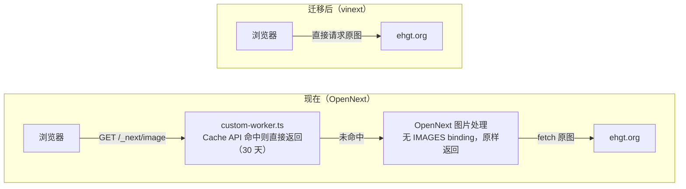

# vinext 迁移评估

评估日期：2026-10-29（首次评估 2026-10-02，第二次 2026-10-28）· 评估对象：`apps/web`（Next.js 16.4.3 + React 19.3.1 + @opennextjs/cloudflare 1.20.13，wrangler 4.153.0）· 对照版本：vinext 1.4.0

## 结论
仍不建议现在把生产环境切到 vinext。上次排在最前面的 OpenNext 安全升级已在 a41223c 完成，Next.js 在 10-14 之后没有新的安全公告，现有生产环境不再有紧急问题，是否试跑 vinext 可以按自己的节奏来。不切的原因仍在 vinext 自身：README 仍不承诺能直接替换 Next.js，对生产使用的说法仍是谨慎使用；上次评估当天又发了 1.4.0，带 6 项行为变化；部署切流量时返回 503 的 #3623 也还开着（官方部署命令可以避开）。

这次依赖升级主要解决了 Next 版本落后的问题。迁移的前置改动里，React 已在评估后升到 19.3.1，满足 vinext 的下限；`middleware.ts` 仍在 `apps/web` 根目录（vinext 会忽略它）。另外这次发现两处迁移时必须处理的地方：

- `tsconfig.json` 的 `paths` 里有 `"react": ["./node_modules/@types/react"]`。按 vinext 1.4.0 的源码，它会被转成 Vite alias，把运行时的 `import 'react'` 改写到类型包。已验证删掉这一项后类型检查仍然通过，可以先在 OpenNext 下删掉
- 最近两个 commit 理顺的 typecheck 链（先跑 `cf-typegen` 再跑 `tsc`，`tsconfig` 包含 `custom-worker.ts`）都绑定在 OpenNext 和 wrangler 上，迁移时要一起改

OpenNext 这边建议再升到 1.20.14，它修了 Next 16 下并发请求可能返回截断响应的问题，见"OpenNext 这条线的现状"。

## 距上次评估的变化

### 本项目：a41223c 之后

| 改动 | 对迁移的影响 |
| --- | --- |
| next 16.2.4 → 16.4.3，@opennextjs/cloudflare 1.19.4 → 1.20.13，wrangler 4.85.0 → 4.153.0（a41223c） | 安全问题已解决，迁移不再和安全升级绑在一起。vinext 的兼容性看板仍跑 Next.js 16.2.6 的测试套件，但本项目用到的 Next API（见兼容性对照）都早于 16.3，影响不大 |
| `react`、`react-dom` 19.2.0 → 19.3.1，`@types/react`、`@types/react-dom` 升到 19.3.0（评估后补做） | 满足 vinext 的下限（≥ 19.3.1），`vinext init` 不会再去升 React。OpenNext 下 App Router 渲染用的是 Next 自带的 React（16.4.3 带的是 19.3.0-canary），装的 React 只被 Pages Router 运行时和 `styled-jsx` 引用，所以这次升级不改变线上页面的渲染 |
| 新增 [locale-html.tsx](../apps/web/src/components/locale-html.tsx)：根布局里由 client 组件用 `useParams` 读 locale 并渲染 `<html lang>`（a117e2c） | 新写法，需实测，见兼容性对照 |
| `typecheck` 改在 `apps/web` 下执行并依赖 `cf-typegen`；`tsconfig` 改为 `allowJs: false`，避免 `tsc` 顺着 `custom-worker.ts` 把 `.open-next` 产物拉进来（161df26、639833d） | 都是围绕 OpenNext 产物和 `wrangler types` 做的。迁移后 `custom-worker.ts` 删除，`allowJs` 那条注释说的理由随之消失；类型生成方式取决于保不保留 wrangler，见兼容性对照的 Nx 一行 |
| `middleware.ts` 仍在 `apps/web` 根目录 | 没变，迁移前仍要移到 `src/` |

### vinext：1.3.1 → 1.4.0

- 1.4.0 发布于 2026-10-28 17:49 UTC，晚于上次评估。主打性能：作者的 Hacker News 基准（1,500 条评论的页面，跑在 Node 上）里，服务端每请求 CPU 比 1.3 少 43%，为 31.1 ms，Next.js 为 33.7 ms。但在另一个内容站原型上，FCP 为 1.67 s，Next.js 为 1.21 s；服务端 CPU 为 130.3 ms，Next.js 为 102.5 ms，仍不如 Next
- 发布文没有把任何变更标为破坏性，但列了 6 项升级时要留意的行为变化。和本项目有关的一项：layout 调 `notFound()` 现在返回 404 并渲染上层最近的 not-found 页，以前是 500。本项目的 `[locale]/layout.tsx` 在 locale 无效时调 `notFound()`，middleware 被忽略时 `/about` 会落到这里，1.4 起返回 404 而不是 500，但仍然不会重定向到 `/en/about`，middleware 照样要移
- `vinext init` 新增 `--ignore-wrangler-config`（[#4216](https://github.com/cloudflare/vinext/pull/4216)）：跳过"已有 wrangler 配置"的检查，生成 `cloudflare.config.ts`，原 wrangler 文件不动也不读。它是为"wrangler 配置属于另一个 Worker"设计的，本项目的 `wrangler.jsonc` 就是 web 自己的，用它时要手动把 D1、自定义域名等配置搬进 `cloudflare.config.ts`，再删掉 `wrangler.jsonc`
- tsconfig `paths` 的精确键改为只匹配完全相同的导入路径（[#4381](https://github.com/cloudflare/vinext/pull/4381)），以前还会匹配它下面的子路径。查这项修复时发现了本项目的 `react` 映射问题
- `check.ts` 只改了 next-intl 的说明文字（experimental 的 messages、precompile 选项现在可用，只剩 extract 不可用），本项目的扫描结果不变
- README 的 "Under active development… not yet a drop-in replacement" 和 FAQ 的 "You can, with caution" 都没变，1.4 发布文对此也只说 vinext 仍 "under active development"
- 兼容性看板（2026-10-29）：已支持部分通过率 99.7%（10-28 为 99.6%），全量 96.2%，App Router 全量 95.0%，仍跑 Next.js 16.2.6 的测试套件
- #3623 仍未关闭，10-02 之后没有新回复；#177 也仍未关闭
- 没有新的安全公告

### 三个重新评估信号

| 信号 | 现状（2026-10-29） |
| --- | --- |
| [#177](https://github.com/cloudflare/vinext/issues/177) 关闭 | 未关闭，7 月之后没有新回复。上游在 [#3953](https://github.com/cloudflare/vinext/pull/3953) 中说明问题已由 [#3513](https://github.com/cloudflare/vinext/pull/3513) 修复，并把 next-intl 官方的 App Router playground（7 种配置）和 App Router 示例连同它们的 Playwright 测试放进 CI，跑在 Workers 生产构建上 |
| `vinext check` 不再把 next-intl 标为部分支持 | 已满足，1.2.0 起标为支持 |
| 1.x 连续稳定几个版本，部署类问题（如 [#3623](https://github.com/cloudflare/vinext/issues/3623)）已修复 | 未满足。1.0.0 之后一个月发了 1.1.0 到 1.4.0 共 6 个版本，1.3.0 带 3 项、1.4.0 带 6 项行为变化。#3623 仍未关闭，维护者认为它只出现在单版本部署（直接 `wrangler deploy`）中，`@vinext/cloudflare deploy` 走渐进发布，可以避开 |

## OpenNext 这条线的现状
上次列的安全升级已在 a41223c 完成：`next` 16.4.3、`@opennextjs/cloudflare` 1.20.13、`wrangler` 4.153.0，`@cloudflare/workers-types` 也跟着升到 v5。vercel/next.js 最近一批公告是 10-14 发布的，修复版本是 16.4.1，16.4.3 都已覆盖；Next 目前最新就是 16.4.3。

还剩几件事，都不紧急，但值得在试跑 vinext 之前做掉：

- 升到 OpenNext 1.20.14（10-28）。它修了一个 Next 16 下的问题：OpenNext 的模块加载补丁对新版 `CacheSignal` 构造函数失效，并发请求可能报 `Cannot perform I/O on behalf of a different request` 并返回截断的响应。按 release 的说法，本项目从升到 Next 16 起就可能受影响，可以先在 Workers Observability 里搜一下这条报错
- 上次建议在 preview 下确认 [custom-worker.ts](../apps/web/custom-worker.ts) 的图片缓存仍然生效，commit 里没有提到，可以补一次
- 删掉 `tsconfig.json` 里的 `react` 映射、把 `middleware.ts` 移到 `src/`：这两项都是为迁移铺路，在 OpenNext 下就能做，也能先在 OpenNext 下验证。同类的 React 升级（19.3.1）已经做完，typecheck、lint 和 OpenNext 构建都通过
- wrangler 最新为 4.155.0，不急

## vinext 1.0 发布文要点
Cloudflare 于 2026-09-28 发布 [Next.js applications, powered by Vite: introducing Vinext 1.0](https://blog.cloudflare.com/vinext-nextjs-on-vite/)，称 vinext 已从 2 月的 AI 实验成长为有客户在高流量生产环境使用的框架。

- 来历：2 月首发时是"一个工程师加一堆 token、一周复刻 Next.js"的实验
- 路由：同时支持 App Router、Pages Router 和混合应用，包括 RSC、Server Actions、API 路由、route handler、middleware 和客户端导航
- 页面生命周期：SSR、构建期预渲染、`output: "export"` 静态导出、页面级 ISR；支持后台和按需 revalidate，可按 path 或 tag 失效
- cache warming：新 Worker 版本先以 0% 流量部署，向该版本请求页面填满缓存后再切流量；还能按真实流量挑出热门页面预热
- 可观测性：兼容 OpenTelemetry 和 Sentry，在 Workers 上接入 Workers Observability
- Workers 一等支持：dev 和生产都跑在 workerd 里，可直接使用 Images、Hyperdrive 等绑定
- 承认的短板：`"use cache"`（Cache Components）只有有限支持，文章称多数团队并没有在用
- 维护方式：每天由 agent 审阅 Next.js canary 的改动并开追踪 issue，每晚用 Next.js 测试套件重新生成兼容性矩阵

迁移和部署命令：

```bash
npx vinext check && npx vinext init          # 迁移现有项目
npx @vinext/cloudflare deploy --warm-cache   # 部署到 Workers，并在切流量前预热缓存
```

## 宣传与现状的出入
博客的口径比仓库自己的说明乐观，以下几点要打折看：

- "99%+ 兼容"是 Next.js 测试套件在"客户最常要的功能"上的通过率，且排除了 Cache Components，不等于 99% 的应用能直接迁移。README 的说法是约 94% 的 Next.js 16 API 有完整或部分支持。[兼容性看板](https://vinext.dev/compatibility) 2026-10-29 的结果是：已支持部分通过率 99.7%，全量 96.2%，其中 App Router 全量 95.0%；跑的是 Next.js 16.2.6 的测试套件，而本项目已经在 16.4.3 上
- 性能数据都是 vinext 自己的基准，结果也不一边倒。1.1 发布文（33 个路由的 App Router 应用）：生产构建比 Next.js 16（Turbopack）快约 27%，dev 冷启动反而慢约 11%。1.4 发布文：Hacker News 基准上服务端 CPU 略少于 Next.js，内容站原型上 FCP 和服务端 CPU 仍不如 Next.js
- 截至 2026-10-29，README 顶部仍写着 "Under active development… not yet a drop-in replacement for every application or production workload"，FAQ 对生产使用的回答仍是 "You can, with caution"
- README 自己说 OpenNext 更成熟、覆盖的 API 更多，求稳就选 OpenNext
- 版本很新、迭代很快：首个版本发布于 2026-02-16，至今共 89 个版本；1.0.0 发布于 2026-09-28，之后是 1.1.0（10-08）、1.2.0（10-14）、1.3.0（10-20）、1.3.1（10-25），最新为 1.4.0（10-28）
- 截至 2026-10-29，仓库有 294 个 open issue（10-02 为 263）、340 个 open PR
- 工具链本身还在变：`vinext init` 的 Cloudflare 默认配置是新的 `cf` CLI 和 `cloudflare.config.ts`。目录里已有 wrangler 配置时 init 会直接报错，可选的做法从两种变成了三种：先把绑定迁到 `cloudflare.config.ts`；加 `--legacy-wrangler-cloudflare-init` 保留 wrangler；或者（1.4 起）加 `--ignore-wrangler-config` 让 init 不管 wrangler 文件。1.3 新增的 Worker Previews 只支持 `cloudflare.config.ts` 项目

## 本项目兼容性对照
项目用的 Next.js 16.4.3 在 vinext 的目标范围（16.x）内，用到的都是 16.3 之前就有的 API。必须实测的是 next-intl 和新加的 `LocaleHtml`，行为会变的是图片，middleware 要挪位置，tsconfig 的 `react` 映射要删，其余多为确定的改动。

| 本项目用法 | vinext 下的情况 | 需要做什么 | 处理 |
| --- | --- | --- | --- |
| [middleware.ts](../apps/web/middleware.ts) 放在 `apps/web` 根目录，页面在 `src/app` | vinext 在 `src/app` 结构下只找 `src/proxy.*` 和 `src/middleware.*`，根目录的文件会被静默忽略；Next 16.4.3 仍能识别它（构建产物 `middleware-manifest.json` 里有）。忽略后 `/about` 这类无语言前缀的路径不再重定向到 `/en/about`，而是被当成 `[locale]=about`，由 layout 的 `notFound()` 返回 404（1.4 之前是 500）；`/` 不受影响（根页面自己做跳转） | 移到 `src/middleware.ts` 并改 `routing` 的引用路径，或直接改成 `src/proxy.ts`。这也是 Next 文档约定的位置（和 `app/` 同级），可以先在 OpenNext 下做 | 需改动 |
| [tsconfig.json](../apps/web/tsconfig.json) 的 `paths`：`"react": ["./node_modules/@types/react"]`（monorepo 重构时加的） | vinext 会读 tsconfig 的 `paths`，把不带 `*` 的键转成锚定的 Vite `resolve.alias`，作用于所有 JS/TS 导入，只跳过 `next/*` 的几个 shim。`react` 不在跳过名单里，运行时的 `import 'react'` 会被改写到 `node_modules/@types/react`，而它的 `exports` 只有 `types` 条件，解析会失败。Next 下构建正常。这条结论来自 1.4.0 源码，未实际运行 vinext 验证 | 删掉这一项。已用覆盖 `paths` 的 tsconfig 跑过 `tsc --noEmit`：删掉后类型检查通过，`@types/react` 照常从 `node_modules` 解析。可以先在 OpenNext 下删 | 需改动 |
| next-intl：6 个 client 组件使用其 hooks，结构为 Provider(client) → page(server) → client 组件 | `vinext check` 1.2.0 起标为支持。[#177](https://github.com/cloudflare/vinext/issues/177) 仍未关闭，但上游说明已由 [#3513](https://github.com/cloudflare/vinext/pull/3513) 修复，next-intl 官方 playground 和 App Router 示例在 vinext CI 的 Workers 生产构建上通过 | 在 `vite dev` 和生产构建（workerd）下实测中英文切换和这 6 个组件；`createNextIntlPlugin` 可去掉，vinext 会自动识别 `src/i18n/request.ts` | 需实测 |
| [locale-html.tsx](../apps/web/src/components/locale-html.tsx)：根布局里由 client 组件渲染 `<html lang>`，locale 来自 `useParams` | vinext 的 `useParams` 在 App Router 下返回整条路由的参数，不按 segment 截断，和 Next 一致，所以在 `[locale]` 之上的根布局里也能拿到 locale。vinext 的测试里有 client 组件渲染 `<html>` 的用例（global-error、next-intl 示例的 not-found），但没有在根布局里这样做的 | 实测 SSR 输出的 `lang`、切换语言后 `lang` 是否更新、`ThemeToggle` 加的 `dark` class 是否保留 | 需实测 |
| `next/image` 远程 `fill` 图（ehgt.org，[image-with-skeleton.tsx](../apps/web/src/components/image-with-skeleton.tsx)） | 直接渲染为 ``，不经过 `/_next/image`；`remotePatterns` 仍会校验 | 决定是否保留同源代理和缓存，见下一节 | 行为变化 |
| [custom-worker.ts](../apps/web/custom-worker.ts)：包装 OpenNext worker，给 `/_next/image` 加 30 天 Cache API 缓存 | 依赖 `.open-next/worker.js`，无法沿用；vinext 访问绑定不需要自定义入口 | 删除，或按新的图片方案重写；同时从 `tsconfig` 的 `include` 里去掉 | 需改动 |
| [open-next.config.ts](../apps/web/open-next.config.ts)：`staticAssetsIncrementalCache` | 不再使用；对应能力是 vinext 的缓存 adapter | 删除；以后需要页面缓存时再配 adapter | 需改动 |
| `getCloudflareContext().env`（[toplist-data.ts](../apps/web/src/lib/toplist-data.ts)） | vinext 下没有这个 API，改用 `cloudflare:workers` 的 `env` | `import { env } from 'cloudflare:workers'` | 需改动 |
| [next.config.ts](../apps/web/next.config.ts)：`reactCompiler: true` | 被忽略 | 改用 `vinext({ react: { compiler: true } })`，安装 `oxc-transform-react`，需要 `@vitejs/plugin-react` 6.1+；只作用于客户端 | 需改动 |
| [wrangler.jsonc](../apps/web/wrangler.jsonc)：D1 远程绑定、自定义域名、observability、兼容性标志 | `vinext init` 默认生成 `cf` CLI 和 `cloudflare.config.ts`，目录里有 `wrangler.jsonc` 时不加参数会直接报错。加 `--legacy-wrangler-cloudflare-init` 时会就地改写 `wrangler.jsonc`，但 `main` 和 `assets` 只在缺失时才补，本项目现有的值指向 `custom-worker.ts` 和 `.open-next/assets`，不会被替换。加 `--ignore-wrangler-config`（1.4 起）时生成 `cloudflare.config.ts`，`wrangler.jsonc` 不动也不再被读取 | 保留 wrangler（crawler 仍用 wrangler）时，先删掉 `main` 和 `assets` 再跑 init，让它按 vinext 的默认值补上；改用 `cloudflare.config.ts` 时，可以用 `--ignore-wrangler-config` 生成它，再把 D1、域名等配置搬过去并删掉 `wrangler.jsonc` | 需改动 |
| Nx：`@nx/next/plugin` 推断 build、dev、start；`typecheck` 依赖 `cf-typegen`（`wrangler types`） | vinext 保留 `next.config.ts`，Nx 仍会推断出 `next build`；vinext 的文档和 issue 里没有 Nx 相关内容。保留 wrangler 时 `wrangler types` 仍可用，只是 `mainModule` 会改指 vinext 的入口；改用 `cloudflare.config.ts` 时 Workers 类型由插件生成到 `.cloudflare/types`，单独类型检查前要跑 `cf workers types`。`vinext typegen` 生成 `.next/types/routes.d.ts` 并改写 `next-env.d.ts`（dev 和 build 时插件也会生成），本项目没用 `PageProps` 等全局类型，可以不接 | 手动定义 build、dev、preview、deploy target；按所选方案调整 `cf-typegen` 和 `tsconfig` 的 `types`、`include` | 需改动 |
| `package.json` 脚本，含 `next experimental-analyze` | `vinext init` 添加 `dev:vinext`、`build:vinext`、`start:vinext`、`deploy:vinext`；analyze 没有对应命令 | 重写脚本，bundle 分析改用 Vite 生态的工具 | 需改动 |
| React 19.3.1（评估后从 19.2.0 升级） | vinext 1.2.1 起要求 `react`、`react-dom`、`react-server-dom-webpack` ≥ 19.3.1，`@vitejs/plugin-rsc` ≥ 0.5.37（0.5.38 起内置 19.3.1 的 RSDW），`vite` ^8 | `react`、`react-dom` 已满足；`react-server-dom-webpack`、`@vitejs/plugin-rsc`、`vite` 由 `vinext init` 安装 | 无需改动 |
| route handler、`cookies()`/`headers()`、`redirect`/`notFound`、`next/link`、`generateStaticParams` | 均支持 | 无 | 无需改动 |

## 图片请求链路的变化
现在缩略图经本站 Worker 代理并缓存 30 天；迁到 vinext 后，浏览器会直连 ehgt.org。



- 现在没配 `IMAGES` binding，OpenNext 的 `/_next/image` 不做压缩或格式转换，只是原样返回原图（1.20.13 的 `dist/cli/templates/images.js` 仍是这样）。实际作用是同源代理，加上 `custom-worker.ts` 的边缘缓存
- 直连的好处是图片请求不再消耗 Worker 调用；代价是失去同源代理和边缘缓存。[todo.md](todo.md) 里记录过直连测速"速度也还行"
- 若要保留代理：给 `<Image>` 传 `loader` 属性（`next.config` 里的 `images.loader` 会被忽略），指向一个代理并缓存图片的 route handler

## 迁移收益
1.0 主打的预渲染、ISR 和 cache warming 对本项目几乎没用，能拿到的主要是工具链层面的改善。

- 升到 Next 16.4.3 后的构建（10-29）仍只预渲染了 `/_global-error` 和 `/_not-found`。首页读 cookies 和 searchParams、每个请求查 D1，about 页也是动态渲染
- 因此 `staticAssetsIncrementalCache` 实际没有缓存任何页面，vinext 的页面缓存能力同样用不上
- 实际能拿到的：
    - 构建更快：按 vinext 1.1 的基准，生产构建比 Next.js 16 快约 27%，但 dev 冷启动慢约 11%；本项目未实测
    - 客户端 JS 更少：1.3 起按路由合并 client 组件的 chunk，官方原型上每页 JS（gzip）比 Next.js 少约 44%；1.4 起 Link 只预取 loading 状态，同一次导航的预取量从 3.9 MB 降到 10.7 kB。但同一原型上 FCP 仍慢于 Next.js（1.67 s 对 1.21 s）
    - dev 直接跑在 workerd 里，绑定原生可用，不再需要 `initOpenNextCloudflareForDev`
    - 去掉 `custom-worker.ts` 这类依赖 OpenNext 构建产物的写法，最近为它在 `tsconfig` 里做的 `allowJs` 规避也可以去掉
    - 不运行 Next.js 的服务端代码，Next.js 的安全公告大多不直接适用（Cloudflare 对 5 月那批漏洞的说明是 vinext 的架构绕开了受影响的代码路径）。但 vinext 有自己的公告，还要及时跟进 React 的补丁版本，相当于换了一条要跟的补丁线。OpenNext 这条线刚升到最新，这项收益眼下也不迫切
- 上次列的 `proxy.ts` 收益已不是 vinext 独有，OpenNext 1.20.3 起实验性支持

工具链收益仍属锦上添花。真正的变化在长期方向：Cloudflare 已把 vinext 作为 Workers 上运行 Next.js 的默认方式，OpenNext 指南也改成了维护现有应用的定位，长期看迁移的理由在增加。但 OpenNext 目前仍在快速跟进 Next 的安全版本（1.20.14 又修了一个 Next 16 的运行时问题），不必急于一时。

## 关于 vinext check
`vinext check` 是 vinext 自带的迁移前静态扫描，只读、不改文件，适合当初筛清单，不能代替实测。`vinext init` 开头也会自动跑一遍（可用 `--skip-check` 跳过）。

```bash
cd apps/web              # monorepo 里要在 Next 应用目录下运行
pnpm dlx vinext check    # 或 npx vinext check，无需先安装 vinext
```

它检查四类内容：

- 导入：源码里的 `next/*` import，对照内置支持表
- next.config：逐项对照配置选项
- 第三方库：用 `package.json` 的依赖对照已知库表
- 项目结构：路由类型，页面、layout、route handler 的数量，`middleware.ts` 与 `proxy.ts` 是否并存，是否用了 `__dirname` / `__filename`

评分方式：支持记 1 分，部分支持记 0.5 分，不支持记 0 分，再取平均。它只反映检测到的条目，不代表应用能跑起来的概率。

本项目扫描结果：

- 2026-10-02，vinext 1.0.1 实测：总分 77%（10 项支持、3 项部分支持、2 项问题），去掉误报后按同一公式约 88%
- 2026-10-28 和 10-29，vinext 1.3.1 和 1.4.0：没有实际运行，按源码推算。1.0.1 到 1.4.0 之间，`check.ts` 里本项目会命中的条目只有 next-intl 从部分支持改为支持（1.4.0 只改了它的说明文字），忽略规则也没变。预计总分 80%（11 项支持、2 项部分支持、2 项问题），去掉误报后约 92%

| 条目 | 结果（1.4.0） | 说明 |
| --- | --- | --- |
| next-intl | 支持（1.0.1 为部分支持） | 说明里提到的 experimental extract 选项本项目没用 |
| `images` 配置 | 部分支持 | 没配 optimizer 时原样返回图片 |
| `reactCompiler` | 部分支持 | 被忽略，需改用 vinext 的配置 |
| `next/dist/server/next-server.js` | 问题（误报） | 来自 `.open-next/` 构建产物 |
| `__dirname` / `__filename` | 问题（误报） | 来自 `.open-next/` 和 `.wrangler/tmp/` 构建产物 |

局限：

1. 不运行应用，测不出运行时问题。#177 中有用户的报告是 96%、0 个问题，实际 client 组件报错。next-intl 的标记 2026-09-28 才改为部分支持（[#3507](https://github.com/cloudflare/vinext/pull/3507)），2026-10-14 又改为支持（[#3953](https://github.com/cloudflare/vinext/pull/3953)），反映的是上游测试的结果，不代表本项目能跑通
2. 会误报。它固定跳过 `node_modules`、`.next`、`dist`、`.git`，且只读扫描目录及其子目录里的 `.gitignore`。本仓库在根目录 `.gitignore` 里忽略 `.open-next` 和 `.wrangler`，在 `apps/web` 运行时这两个目录会被扫进去。解决办法是在 `apps/web` 加一个 `.gitignore` 列出这两个目录；不要直接删 `.wrangler`，里面可能有本地 D1 数据
3. 只认识表里的库。`@tanstack/react-table`、`zustand`、`react-day-picker` 等不在表里，不会出现在报告中
4. 只看 Next.js 层面。`custom-worker.ts`、`getCloudflareContext()`、`wrangler.jsonc`、Nx 配置、tsconfig 的 `paths` 都不在报告里，但迁移时都要改
5. 会漏报。它和插件一样，在 `src/app` 结构下只在 `src/` 里找 middleware，根目录的 `middleware.ts` 既不计分也不提示。1.0.1 的结果里没有 middleware 一项就是这个原因

## 建议
OpenNext 上的安全升级已经完成，下一步是在 OpenNext 下把迁移的前置改动做掉，再开分支试跑 vinext；试跑全部通过、部署问题有着落之后，再考虑切换生产。

第一步，在 OpenNext 下收尾并铺路（不依赖 vinext，可以单独上线）。React 已升到 19.3.1，剩下：

- `@opennextjs/cloudflare` 升到 1.20.14，修复并发请求可能返回截断响应的问题
- 删掉 `apps/web/tsconfig.json` 里的 `"react": ["./node_modules/@types/react"]`
- 把 `middleware.ts` 移到 `src/`，或者直接重试 [todo.md](todo.md) 里的 `proxy.ts` 迁移（OpenNext 1.20.3 起实验性支持）
- 验证 `pnpm nx typecheck web`、`pnpm nx build web`，在 preview 下检查首页、`/about` 的重定向、`/api/data` 和图片缓存

第二步，开分支试跑 vinext。`vinext init` 不改源码、`next.config` 和 `tsconfig.json`，也不移除 Next.js 依赖；它会安装 `vite`、`@vitejs/plugin-rsc`、`react-server-dom-webpack` 等依赖（React 已满足下限，不会再升级），生成 `vite.config.ts`，添加 `*:vinext` 脚本。`apps/web` 里已有 `wrangler.jsonc`，要么保留 wrangler（先删掉其中的 `main` 和 `assets`），要么改用 `cloudflare.config.ts`（见兼容性对照）：

```bash
cd apps/web
pnpm dlx vinext check
# 保留 wrangler：
pnpm dlx vinext init --platform=cloudflare --legacy-wrangler-cloudflare-init
# 或改用 cloudflare.config.ts，之后手动迁移绑定并删掉 wrangler.jsonc：
pnpm dlx vinext init --platform=cloudflare --ignore-wrangler-config
```

试跑验证清单：

- [ ] `middleware.ts` 移到 `src/` 后，`/about` 能重定向到 `/en/about`，无效路径返回 404
- [ ] tsconfig 里没有 `react` 映射，`vite dev` 下 `react` 正常解析
- [ ] 中英文切换正常，6 个使用 next-intl 的 client 组件在 `vite dev` 下没有 intl context 报错
- [ ] `<html lang>` 在 SSR 输出和切换语言后都正确，`ThemeToggle` 的 `dark` class 切换语言后保留
- [ ] 同样的检查在生产构建（workerd）下通过
- [ ] 首页和 `/api/data` 通过 `cloudflare:workers` 的 `env` 正常查询 D1
- [ ] 决定图片方案：接受直连 ehgt.org，或用 `loader` + route handler 保留代理和缓存
- [ ] Nx 的 build、dev、typecheck、deploy target 走通，typecheck 按所选方案生成 Workers 类型；部署用 `vinext-cloudflare deploy`（渐进发布，避开 #3623）

切换生产的条件：

- 上面的清单全部通过
- #3623 关闭，或确认用 `vinext-cloudflare deploy` 部署时不复现
- 小版本不再频繁带需要手动处理的变化（1.3.0 有 3 项，1.4.0 有 6 项）

## 参考资料
- [Next.js applications, powered by Vite: introducing Vinext 1.0](https://blog.cloudflare.com/vinext-nextjs-on-vite/)（Cloudflare 博客，2026-09-28）
- vinext 发布文：[1.1](https://vinext.dev/blog/vinext-1-1)（2026-10-08）、[1.2](https://vinext.dev/blog/vinext-1-2)（2026-10-14）、[1.3](https://vinext.dev/blog/vinext-1-3)（2026-10-20）、[1.4](https://vinext.dev/blog/vinext-1-4)（2026-10-28）
- [vinext 1.4.0 release notes](https://github.com/cloudflare/vinext/releases/tag/vinext%401.4.0)
- [vinext 兼容性看板](https://vinext.dev/compatibility)
- [cloudflare/vinext README](https://github.com/cloudflare/vinext)
- [Differences from Next.js](https://github.com/cloudflare/vinext/blob/main/docs/reference/differences.mdx)
- [Deploy to Cloudflare Workers](https://github.com/cloudflare/vinext/blob/main/docs/deploying/cloudflare.mdx)：`cloudflare.config.ts` 项目的 Workers 类型生成到 `.cloudflare/types`，单独类型检查前跑 `cf workers types`
- [migrate-to-vinext 兼容性参考](https://github.com/cloudflare/vinext/blob/main/.agents/skills/migrate-to-vinext/references/compatibility.md)
- [vinext check 源码（check.ts）](https://github.com/cloudflare/vinext/blob/main/packages/vinext/src/check.ts)
- [vinext 插件入口（index.ts）](https://github.com/cloudflare/vinext/blob/main/packages/vinext/src/index.ts)：`middlewareConventionDir` 决定在哪个目录找 middleware；`materializeTsconfigPathAliases` 和 `buildResolveAliasEntries` 把 tsconfig `paths` 转成 Vite alias，`_reactServerShims` 是唯一的跳过名单
- [vinext init 的 Cloudflare 配置（init-cloudflare.ts）](https://github.com/cloudflare/vinext/blob/main/packages/vinext/src/init-cloudflare.ts)：已有 wrangler 配置时的报错、`--ignore-wrangler-config`，以及 `updateWranglerConfigForCloudflare` 只补缺失的 `main` 和 `assets`
- [vinext 的 navigation shim（navigation.ts）](https://github.com/cloudflare/vinext/blob/main/packages/vinext/src/shims/navigation.ts)：`useParams` 的实现
- [vinext typegen（typegen.ts）](https://github.com/cloudflare/vinext/blob/main/packages/vinext/src/typegen.ts)
- [vinext 的 next/image 实现（image.tsx）](https://github.com/cloudflare/vinext/blob/main/packages/vinext/src/shims/image.tsx)
- [vinext 的 next-intl e2e 测试](https://github.com/cloudflare/vinext/blob/main/tests/e2e/app-router/next-intl.browser.spec.ts)
- [vinext 安全公告](https://github.com/cloudflare/vinext/security/advisories)
- [#177 Issues with `next-intl` library](https://github.com/cloudflare/vinext/issues/177)
- [#3507 fix(check): refresh import and library support entries](https://github.com/cloudflare/vinext/pull/3507)
- [#3513 fix(dev): stabilize next-intl cold rendering and hydration](https://github.com/cloudflare/vinext/pull/3513)
- [#3623 Empty-body 503 returned to real requests during deployment rollout](https://github.com/cloudflare/vinext/issues/3623)
- [#3953 test(next-intl): run next-intl's App Router playground on a Workers build](https://github.com/cloudflare/vinext/pull/3953)
- [#3973 test(next-intl): run next-intl's canonical App Router example on a Workers build](https://github.com/cloudflare/vinext/pull/3973)
- [#3995 fix(deps): require React 19.3.1](https://github.com/cloudflare/vinext/pull/3995)
- [#4045 notFound() thrown in a layout renders that segment's not-found.tsx without the layout's providers](https://github.com/cloudflare/vinext/issues/4045)
- [#4216 feat(init): add --ignore-wrangler-config for Cloudflare init](https://github.com/cloudflare/vinext/pull/4216)
- [#4381 fix(config): match exact tsconfig paths keys only against the exact specifier](https://github.com/cloudflare/vinext/pull/4381)
- Cloudflare 文档：[Next.js](https://developers.cloudflare.com/workers/framework-guides/web-apps/nextjs/)、[OpenNext adapter](https://developers.cloudflare.com/workers/framework-guides/web-apps/opennext/)
- [WAF and framework adapter mitigations for React and Next.js vulnerabilities](https://developers.cloudflare.com/changelog/post/2026-05-06-react-nextjs-vulnerabilities/)（Cloudflare changelog，2026-05-07）
- [Next.js Security Update for Upstream Vulnerabilities](https://nextjs.org/blog/nextjs-security-update-october-14-2026)（Next.js 博客，2026-10-14）
- [vercel/next.js 安全公告](https://github.com/vercel/next.js/security/advisories)
- [@opennextjs/cloudflare releases](https://github.com/opennextjs/opennextjs-cloudflare/releases)：1.20.3 加入 `proxy.ts` 支持，1.20.7 起提高 Next 版本下限，1.20.14 修复 Next 16 下并发请求的截断问题
- 本地 `@opennextjs/cloudflare` 1.20.13 的 `dist/cli/templates/images.js`：未配置 `env.IMAGES` 时返回原图
- 本地 `apps/web/.next/server/middleware-manifest.json`：Next 16.4.3 的构建包含根目录的 `middleware.ts`
- 本地 `apps/web/.next/prerender-manifest.json`：Next 16.4.3 的构建只预渲染了 `/_global-error` 和 `/_not-found`
