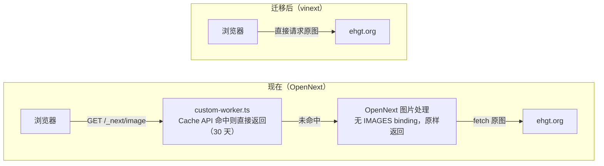

# vinext 迁移评估

评估日期：2026-10-02 · 评估对象：`apps/web`（Next.js 16.2.4 + @opennextjs/cloudflare 1.19.4）· 对照版本：vinext 1.0.1

## 结论
不建议现在把生产环境从 OpenNext 迁到 vinext。对本项目收益有限，风险集中在 next-intl 和图片代理两处。可以先开分支试跑，等 next-intl 的兼容问题（[#177](https://github.com/cloudflare/vinext/issues/177)）关闭后再评估。

## vinext 1.0 发布文要点
Cloudflare 于 2026-09-28 发布 [Next.js applications, powered by Vite: introducing Vinext 1.0](https://blog.cloudflare.com/vinext-nextjs-on-vite/)，称 vinext 已从 2 月的 AI 实验成长为有客户在高流量生产环境使用的框架。

- 来历：2 月首发时是"一个工程师加一堆 token、一周复刻 Next.js"的实验
- 路由：同时支持 App Router、Pages Router 和混合应用，包括 RSC、Server Actions、API 路由、route handler、middleware 和客户端导航
- 页面生命周期：SSR、构建期预渲染、`output: "export"` 静态导出、页面级 ISR；支持后台和按需 revalidate，可按 path 或 tag 失效
- cache warming：新 Worker 版本先以 0% 流量部署，向该版本请求页面填满缓存后再切流量；还能按真实流量挑出热门页面预热
- 可观测性：兼容 OpenTelemetry 和 Sentry，在 Workers 上接入 Workers Observability
- Workers 一等支持：dev 和生产都跑在 workerd 里，可直接使用 Images、Hyperdrive 等绑定
- 承认的短板：`"use cache"`（Cache Components）只有有限支持，文章称多数团队并没有在用
- 维护方式：每天由 agent 审阅 Next.js canary 的改动并开追踪 issue，每晚用 Next.js 测试套件重新生成兼容性矩阵

迁移和部署命令：

```bash
npx vinext check && npx vinext init          # 迁移现有项目
npx @vinext/cloudflare deploy --warm-cache   # 部署到 Workers，并在切流量前预热缓存
```

## 宣传与现状的出入
博客的口径比仓库自己的说明乐观，以下几点要打折看：

- "99%+ 兼容"是 Next.js 测试套件在"客户最常要的功能"上的通过率，且排除了 Cache Components，不等于 99% 的应用能直接迁移。README 的说法是约 94% 的 Next.js 16 API 有完整或部分支持
- 1.0 发布文没有任何性能数据。据 README，2 月首发博客给过构建时间、bundle 体积等数据，README 也说这些数字只能当方向参考
- 同期 README 顶部仍写着 "Under active development… not yet a drop-in replacement for every application or production workload"，FAQ 对生产使用的回答是 "You can, with caution"
- README 自己说 OpenNext 更成熟、覆盖的 API 更多，求稳就选 OpenNext
- 版本很新、迭代很快：首个版本发布于 2026-02-16，至今共 83 个版本；1.0.0 发布于 2026-09-28，1.0.1 发布于 2026-10-01
- 截至 2026-10-02，仓库有 263 个 open issue、341 个 open PR。其中 [#3623](https://github.com/cloudflare/vinext/issues/3623)（基于 1.0.0-beta.11）报告部署切流量期间，部分请求返回空 body 的 503
- 工具链本身还在变：`vinext init` 的 Cloudflare 默认配置已换成新的 `cf` CLI 和 `cloudflare.config.ts`，旧的 wrangler 配置不会自动迁移

## 本项目兼容性对照
项目用的 Next.js 16.2.4 正是 vinext 的目标版本（16.x）。必须实测的是 next-intl，行为会变的是图片，其余多为确定的改动。

| 本项目用法 | vinext 下的情况 | 需要做什么 | 处理 |
| --- | --- | --- | --- |
| next-intl：6 个 client 组件使用其 hooks，结构为 Provider(client) → page(server) → client 组件 | `vinext check` 标为部分支持：client 组件可能报 "No intl context found"（[#177](https://github.com/cloudflare/vinext/issues/177)，未关闭）。官方 e2e 测试覆盖了相同结构，[#3513](https://github.com/cloudflare/vinext/pull/3513) 于 2026-09-27 修复了 dev 模式下的冷启动渲染和水合问题 | 在 `vite dev` 和生产构建（workerd）下实测中英文切换和这 6 个组件；`createNextIntlPlugin` 可去掉，vinext 会自动识别 `src/i18n/request.ts` | 需实测 |
| `next/image` 远程 `fill` 图（ehgt.org，[image-with-skeleton.tsx](../apps/web/src/components/image-with-skeleton.tsx)） | 直接渲染为 ``，不经过 `/_next/image`；`remotePatterns` 仍会校验 | 决定是否保留同源代理和缓存，见下一节 | 行为变化 |
| [custom-worker.ts](../apps/web/custom-worker.ts)：包装 OpenNext worker，给 `/_next/image` 加 30 天 Cache API 缓存 | 依赖 `.open-next/worker.js`，无法沿用；vinext 访问绑定不需要自定义入口 | 删除，或按新的图片方案重写 | 需改动 |
| [open-next.config.ts](../apps/web/open-next.config.ts)：`staticAssetsIncrementalCache` | 不再使用；对应能力是 vinext 的缓存 adapter | 删除；以后需要页面缓存时再配 adapter | 需改动 |
| `getCloudflareContext().env`（[toplist-data.ts](../apps/web/src/lib/toplist-data.ts)） | vinext 下没有这个 API，改用 `cloudflare:workers` 的 `env` | `import { env } from 'cloudflare:workers'` | 需改动 |
| [next.config.ts](../apps/web/next.config.ts)：`reactCompiler: true` | 被忽略 | 改用 `vinext({ react: { compiler: true } })`，安装 `oxc-transform-react`，需要 `@vitejs/plugin-react` 6.1+；只作用于客户端 | 需改动 |
| [wrangler.jsonc](../apps/web/wrangler.jsonc)：D1 远程绑定、自定义域名、observability、兼容性标志 | `vinext init` 默认生成 `cf` CLI 和 `cloudflare.config.ts`，旧配置不会自动迁移 | 手动迁移，或加 `--legacy-wrangler-cloudflare-init` 保留 wrangler（crawler 仍用 wrangler） | 需改动 |
| Nx：`@nx/next/plugin` 推断 build、dev、start | vinext 保留 `next.config.ts`，Nx 仍会推断出 `next build`；vinext 的文档和 issue 里没有 Nx 相关内容 | 手动定义 build、dev、preview、deploy target | 需改动 |
| `package.json` 脚本，含 `next experimental-analyze` | 改用 `vite dev`、`vite build`、`vinext-cloudflare deploy`；analyze 没有对应命令 | 重写脚本，bundle 分析改用 Vite 生态的工具 | 需改动 |
| React 19.2.0 | vinext 的 peer 依赖要求 `react`、`react-dom`、`react-server-dom-webpack` ≥ 19.2.6，`vite` ^8 | 升级依赖 | 需改动 |
| middleware.ts、route handler、`cookies()`/`headers()`、`redirect`/`notFound`、`next/link`、`generateStaticParams` | 均支持；`proxy.ts` 也支持 | 无 | 无需改动 |

## 图片请求链路的变化
现在缩略图经本站 Worker 代理并缓存 30 天；迁到 vinext 后，浏览器会直连 ehgt.org。



- 现在没配 `IMAGES` binding，OpenNext 的 `/_next/image` 不做压缩或格式转换，只是原样返回原图（见 `@opennextjs/cloudflare` 的 `dist/cli/templates/images.js`）。实际作用是同源代理，加上 `custom-worker.ts` 的边缘缓存
- 直连的好处是图片请求不再消耗 Worker 调用；代价是失去同源代理和边缘缓存。[todo.md](todo.md) 里记录过直连测速"速度也还行"
- 若要保留代理：给 `<Image>` 传 `loader` 属性（`next.config` 里的 `images.loader` 会被忽略），指向一个代理并缓存图片的 route handler

## 迁移收益
1.0 主打的预渲染、ISR 和 cache warming 对本项目几乎没用，能拿到的主要是工具链层面的改善。

- 最近一次 OpenNext 构建只预渲染了 `/_global-error` 和 `/_not-found`。首页读 cookies 和 searchParams、每个请求查 D1，about 页也是动态渲染
- 因此 `staticAssetsIncrementalCache` 实际没有缓存任何页面，vinext 的页面缓存能力同样用不上
- 实际能拿到的：
    - 构建更快（Vite 8 / Rolldown），客户端 bundle 和 Worker 体积更小，幅度未在本项目实测
    - dev 直接跑在 workerd 里，绑定原生可用，不再需要 `initOpenNextCloudflareForDev`
    - 去掉 `custom-worker.ts` 这类依赖 OpenNext 构建产物的写法
    - vinext 支持 `proxy.ts`，[todo.md](todo.md) 里因 OpenNext 报错搁置的 `middleware.ts` → `proxy.ts` 迁移可以顺带完成

这些都属于锦上添花，不构成迁移的硬理由。

## 关于 vinext check
`vinext check` 是 vinext 自带的迁移前静态扫描，只读、不改文件，适合当初筛清单，不能代替实测。`vinext init` 开头也会自动跑一遍（可用 `--skip-check` 跳过）。

```bash
cd apps/web              # monorepo 里要在 Next 应用目录下运行
pnpm dlx vinext check    # 或 npx vinext check，无需先安装 vinext
```

它检查四类内容：

- 导入：源码里的 `next/*` import，对照内置支持表
- next.config：逐项对照配置选项
- 第三方库：用 `package.json` 的依赖对照已知库表
- 项目结构：路由类型，页面、layout、route handler 的数量，`middleware.ts` 与 `proxy.ts` 是否并存，是否用了 `__dirname` / `__filename`

评分方式：支持记 1 分，部分支持记 0.5 分，不支持记 0 分，再取平均。它只反映检测到的条目，不代表应用能跑起来的概率。

本项目扫描结果（2026-10-02，vinext 1.0.1）：总分 77%（10 项支持、3 项部分支持、2 项问题），去掉误报后按同一公式约 88%。

| 条目 | 结果 | 说明 |
| --- | --- | --- |
| next-intl | 部分支持 | client 组件可能报 "No intl context found"（#177） |
| `images` 配置 | 部分支持 | 没配 optimizer 时原样返回图片 |
| `reactCompiler` | 部分支持 | 被忽略，需改用 vinext 的配置 |
| `next/dist/server/next-server.js` | 问题（误报） | 来自 `.open-next/` 构建产物 |
| `__dirname` / `__filename` | 问题（误报） | 来自 `.open-next/` 和 `.wrangler/tmp/` 构建产物 |

局限：

1. 不运行应用，测不出运行时问题。#177 中有用户的报告是 96%、0 个问题，实际 client 组件报错；next-intl 的部分支持标记是 2026-09-28 才由 [#3507](https://github.com/cloudflare/vinext/pull/3507) 加入
2. 会误报。它固定跳过 `node_modules`、`.next`、`dist`、`.git`，且只读扫描目录及其子目录里的 `.gitignore`。本仓库在根目录 `.gitignore` 里忽略 `.open-next` 和 `.wrangler`，在 `apps/web` 运行时这两个目录会被扫进去。解决办法是在 `apps/web` 加一个 `.gitignore` 列出这两个目录；不要直接删 `.wrangler`，里面可能有本地 D1 数据
3. 只认识表里的库。`@tanstack/react-table`、`zustand`、`react-day-picker` 等不在表里，不会出现在报告中
4. 只看 Next.js 层面。`custom-worker.ts`、`getCloudflareContext()`、`wrangler.jsonc`、Nx 配置都不在报告里，但迁移时都要改

## 建议
生产继续用 OpenNext；想摸底就开分支并行试跑，出现下面的信号再考虑切换。

`vinext init` 是非破坏性的：会安装依赖，添加 `dev:vinext`、`build:vinext`、`start:vinext` 脚本，生成 `vite.config.ts` 和 Cloudflare 配置；不改源码、`next.config` 和 `tsconfig.json`，也不移除 Next.js 依赖。

```bash
cd apps/web
pnpm dlx vinext init --platform=cloudflare
# 想继续用 wrangler 配置时加 --legacy-wrangler-cloudflare-init
```

试跑验证清单：

- [ ] 中英文切换正常，6 个使用 next-intl 的 client 组件在 `vite dev` 下没有 intl context 报错
- [ ] 同样的检查在生产构建（workerd）下通过
- [ ] 首页和 `/api/data` 通过 `cloudflare:workers` 的 `env` 正常查询 D1
- [ ] 决定图片方案：接受直连 ehgt.org，或用 `loader` + route handler 保留代理和缓存
- [ ] Nx 的 build、dev、deploy target 和部署流程走通

重新评估的信号：

- [#177](https://github.com/cloudflare/vinext/issues/177) 关闭
- `vinext check` 不再把 next-intl 标为部分支持
- 1.0.x 连续稳定几个版本（例如到 1.1），部署类问题（如 #3623）已修复

## 参考资料
- [Next.js applications, powered by Vite: introducing Vinext 1.0](https://blog.cloudflare.com/vinext-nextjs-on-vite/)（Cloudflare 博客，2026-09-28）
- [cloudflare/vinext README](https://github.com/cloudflare/vinext)
- [Differences from Next.js](https://github.com/cloudflare/vinext/blob/main/docs/reference/differences.mdx)
- [Deploy to Cloudflare Workers](https://github.com/cloudflare/vinext/blob/main/docs/deploying/cloudflare.mdx)
- [migrate-to-vinext 兼容性参考](https://github.com/cloudflare/vinext/blob/main/.agents/skills/migrate-to-vinext/references/compatibility.md)
- [vinext check 源码（check.ts）](https://github.com/cloudflare/vinext/blob/main/packages/vinext/src/check.ts)
- [vinext 的 next/image 实现（image.tsx）](https://github.com/cloudflare/vinext/blob/main/packages/vinext/src/shims/image.tsx)
- [vinext 的 next-intl e2e 测试](https://github.com/cloudflare/vinext/blob/main/tests/e2e/app-router/next-intl.browser.spec.ts)
- [#177 Issues with `next-intl` library](https://github.com/cloudflare/vinext/issues/177)
- [#3507 fix(check): refresh import and library support entries](https://github.com/cloudflare/vinext/pull/3507)
- [#3513 fix(dev): stabilize next-intl cold rendering and hydration](https://github.com/cloudflare/vinext/pull/3513)
- [#3623 Empty-body 503 returned to real requests during deployment rollout](https://github.com/cloudflare/vinext/issues/3623)
- 本地 `@opennextjs/cloudflare` 1.19.4 的 `dist/cli/templates/images.js`：未配置 `env.IMAGES` 时返回原图
